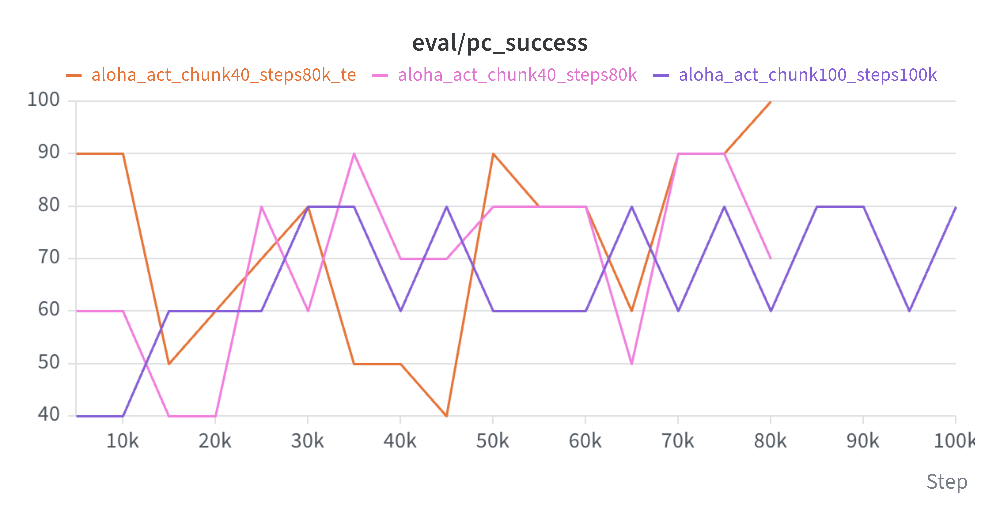
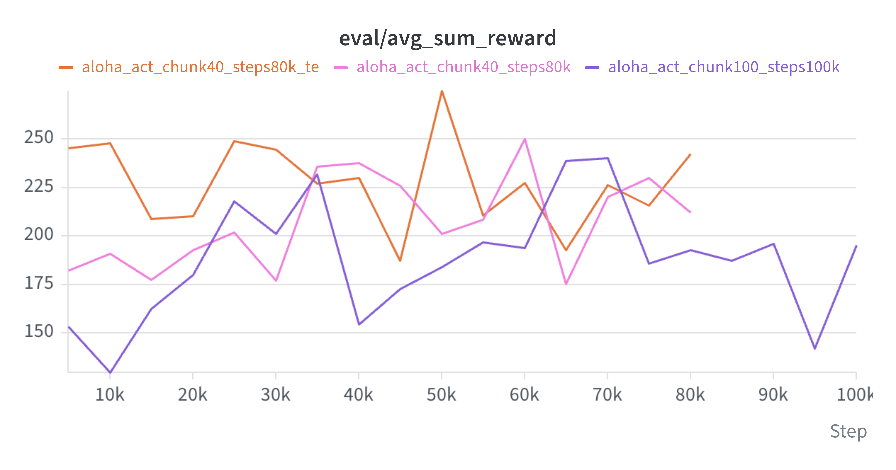
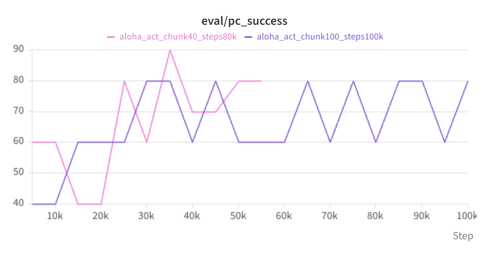
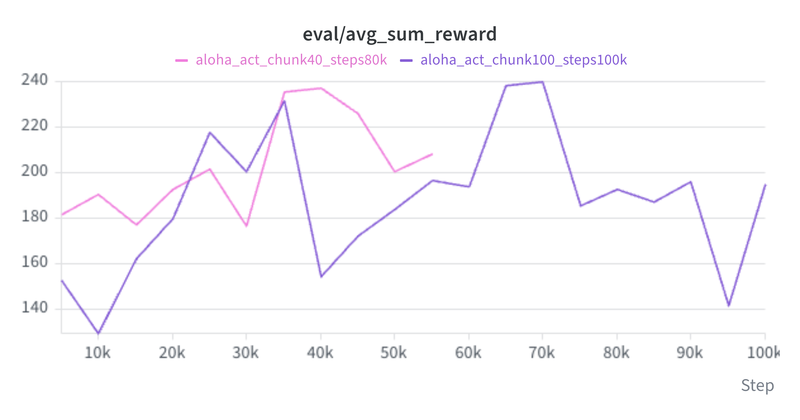
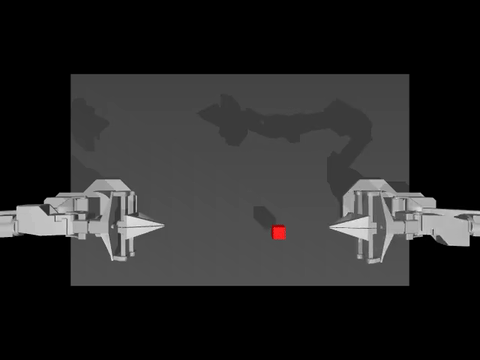
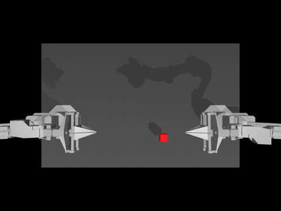
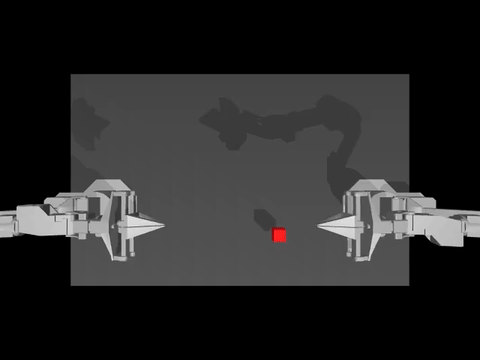

# ACT on ALOHA Transfer Cube

Training ACT on ALOHA sim (transfer cube) with lerobot, and comparing to the reference number.

**TL;DR:** Reproduced lerobot's reference ACT result (**82%** vs 83% paper claims). Then ablated chunk size: chunk 40 learns sooner but finishes lower (70%) and freezes on teleop pauses. Adding temporal ensembling takes chunk 40 to **92%**, with visibly smoother motion.

## What's here

- `explore_dataset.py`: loads the dataset, prints features and one sample.
- `explore_chunks.py`: pulls `(100, 14)` action chunks straight from the parquet, no video decoding.
- `act_aloha_train.sh`: `lerobot-train` configs. Local smoke test, cloud runs for each config below.
- `act_aloha_rollout.sh`: `lerobot-eval` on a saved checkpoint.
- `media/`: charts and eval rollouts used in this README.

## Progress

- [x] Smoke test, 10 steps
- [x] 1k steps locally, checkpoints at 500 and 1000
- [x] 100k on Vast (RTX 3090), eval every 5k, final checkpoint only
- [x] Compare to the reference 83%
- [x] `chunk_size=40` run
- [x] `chunk_size=40` + temporal ensembling run
- [x] Chunk size ablation & observations

## Chunk Size Ablation

**Hypotheses**

1. Reducing the chunk size makes the model learn sooner.
2. Chunk size + temporal ensembling makes the model's actions smoother.

**Runs**

| Run | `chunk_size` | `n_action_steps` | Temporal ensemble | Steps | Eval eps (during training) |
|---|---|---|---|---|---|
| Chunk 100 | 100 | 100 | no | 100k | 5 |
| Chunk 40 | 40 | 40 | no | 80k | 10 |
| Chunk 40 + TE | 40 | 1 | yes (0.01) | 80k | 10 |

### Results

Final evals: 50 episodes, same seeds for every model, so episode `i` starts from the same cube position across runs.

| Run | `pc_success` | `avg_max_reward` | Never touched | Touched only | Lifted only | Transferred | Eval s/episode |
|---|---|---|---|---|---|---|---|
| Chunk 100 (100k) | 82% | 3.50 | 1 | 5 | 3 | 41 | 7.2 |
| Chunk 40 (80k) | 70% | 3.26 | 0 | 7 | 8 | 35 | 7.6 |
| **Chunk 40 + TE (80k)** | **92%** | **3.80** | 0 | 2 | 2 | 46 | 15.2 |
| Reference (lerobot) | 83% | 3.55 | | | | | |

The middle columns count where each episode stopped. TE is ~2× slower to evaluate because it queries the policy every step instead of every 40.

| `pc_success` | `avg_sum_reward` |
|---|---|
|  |  |

These curves are the evals during training (10 episodes, 5 for chunk 100), so they move in 10-20 point jumps. The table above is the reliable number.

### Observations

#### Chunk 100 vs chunk 40

- Chunk 100 at 100k matched the reference: 82% vs 83%.
- Chunk 40 hit 60% success at 5k, way sooner than chunk 100, but finished lower.

| `pc_success` | `avg_max_reward` |
|---|---|
|  |  |

**Where they failed**

| Stopped at | Chunk 100 | Chunk 40 |
|---|---|---|
| Never touched | 1 | 0 |
| Touched, no lift | 5 | 7 |
| Lifted, no handover | 3 | 8 |
| Transferred | 41 | 35 |

Chunk 40 grabs the cube fine but fails ~3× more at the handover, the long two-arm part. Episode 0, lifted but no handover:

**Why I think**

Without temporal ensembling, chunk 100 executes all 100 actions (2 s blind) before looking at the camera again. Chunk 40 replans every 0.8 s and can correct itself more often. So without temporal ensembling there should be a sweet spot for chunk size, rather than bigger always being better.

#### Freezing

Chunk 40 froze in one eval episode and got stuck in a loop.

- This is the teleop pause problem from my [survey notes](../robot-learning-survey.md). Humans pause mid-demo, say 2 s at 50 fps = 100 frames of "no action". A 40-step chunk fits entirely inside that pause, so the target is "stay still" all the way through.
- Why a loop: robot stays still → camera sees the same frame → model predicts "stay still" again. Nothing in the observation changes to break it out.
- So smaller chunks learn sooner but are more exposed to freezing. Part of why the sweet spot isn't just "as small as possible". This is more apparent for human demos than for scripted ones.

#### Temporal ensembling

- The temporal ensembling run fixed the freezing problem, and its eval episodes are much smoother.
- Chunk 100 is much clunkier on the same episode.
- TE leads on `avg_sum_reward` from the very first eval. That metric adds up reward over every step, so it also rewards finishing faster, which fits the smoother motion.

Same episode (5), same cube position, both succeed:

| Chunk 40 + TE | Chunk 100 |
|---|---|
|  |  |

## Learning

- The reference loss is basically flat by ~40k steps but success keeps climbing until ~80k. The loss curve doesn't tell you when to stop.
- Transfer cube task = 50 episodes × 400 frames = 20,000 frames, 50 fps (8 s per demo), 14 dof (2 arms × 7). Insertion = 50 × 500 = 25,000.
- Model is 51.6M params, ~206 MB fp32.
    - Transformer encoder 17.6M (34%), VAE encoder 17.4M (34%), ResNet18 11.2M (22%), transformer decoder 5.4M (11%), action head 7K.
    - The VAE encoder is a third of the model and is thrown away at inference. The deployed policy is ~34M.
    - The decoder is 1 layer vs the encoder's 4. The output head (512 → 14) is rounding error.
    - ResNet18 starts from ImageNet weights (`ResNet18_Weights.IMAGENET1K_V1`), with `FrozenBatchNorm2d`. Not training vision from scratch.
- Config defaults straight from the paper: `chunk_size=100`, `n_action_steps=100`, `use_vae=True`, `latent_dim=32`, `kl_weight=10.0`, `optimizer_lr=1e-5`, `dim_model=512`, `n_heads=8` (used as-is in my training runs).
- `temporal_ensemble_coeff=None` by default, so temporal ensembling is **off** unless you turn it on. Paper value is 0.01.
- `ACTConfig.__post_init__` enforces `n_action_steps <= chunk_size`, and `n_action_steps == 1` when temporal ensembling is on, since it has to re-query every step to build the average.
- The question table is `chunk_size` rows, so `--policy.chunk_size=20` builds a smaller `(20, 512)` table.
- `select_action` keeps a queue: predicts the chunk, pops one action per call, only re-runs the model when the queue is empty. Call `policy.reset()` before each episode.
- Loss = `l1_loss + 10 × kld_loss`. L1 is masked by `action_is_pad` because chunks near the end of an episode run out of real future actions.

## Follow up
- [ ] Run `kl_weight=5.0`
