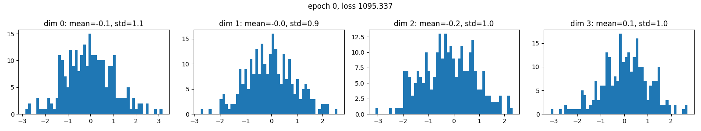
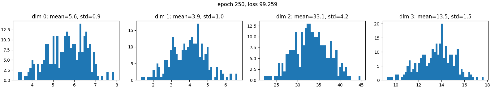
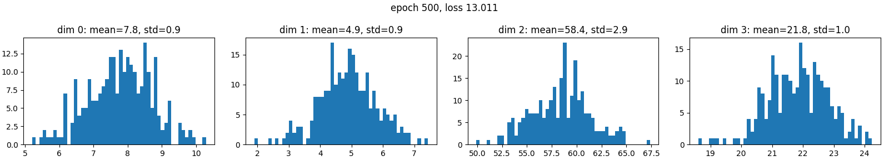
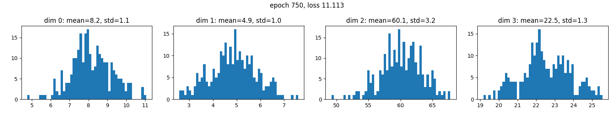
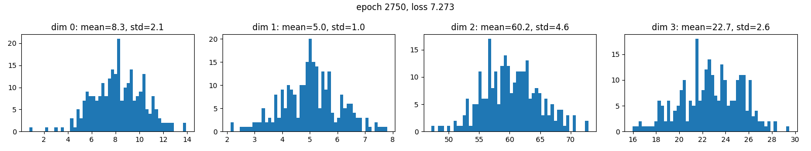
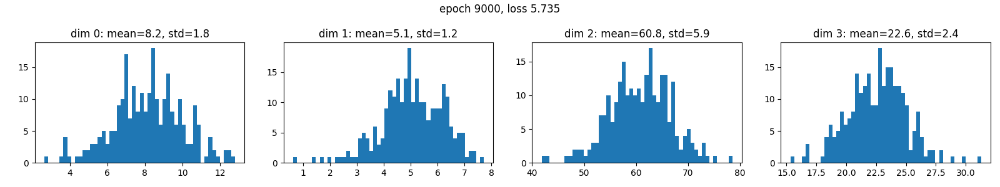
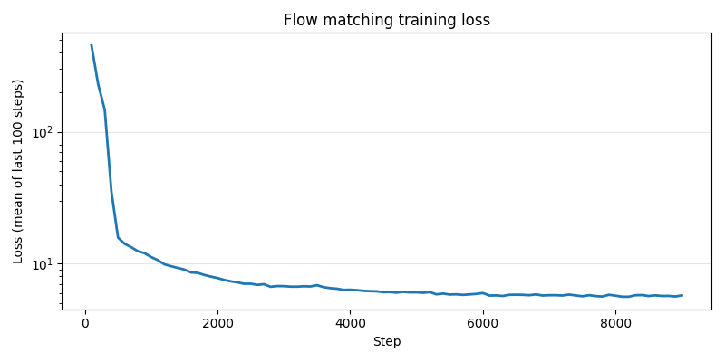
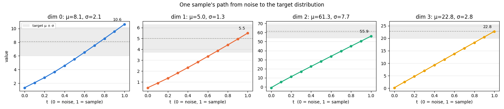

# Flow Matching From Scratch

Flow matching implementation in PyTorch, trained on a toy problem: turn Gaussian noise into samples from a target distribution.

**TL;DR:** An MLP learns a velocity field that carries `N(0, I)` noise to a 4-dim Gaussian. After 9000 steps the sampled means land within ~2% of the targets. Standard deviations come out 8-23% too narrow, worst on dim 2. A single sample's path from noise to target is almost a straight line.

## What's here

- `flow_matching.py`: model, training loop, Euler sampler, plotting, checkpoint save/load.
- `plots/`: run 1 histograms at the steps shown below, run 2's final histogram, its loss curve, and one sample's trajectory.
- `checkpoints/`: trained weights (run 2).

## The toy problem

The target is a 4-dim Gaussian with independent dimensions:

| Dim | Mean | Std |
|---|---|---|
| 0 | 8.1 | 2.1 |
| 1 | 5.0 | 1.3 |
| 2 | 61.3 | 7.7 |
| 3 | 22.8 | 2.8 |

The model never sees these numbers. It only sees samples drawn from this distribution, the same way a robot policy only sees demos.

## How it works

**Training.** For every row in the batch, independently:

1. `x1`: a sample from the target (the "demo").
2. `x0 ~ N(0, I)`: noise.
3. `t ~ U(0, 1)`: a random time.
4. Point on the straight line from noise to sample: `xt = (1 - t) * x0 + t * x1`.
5. Regress the model's velocity onto that line's velocity: `loss = MSE(model(xt, t), x1 - x0)`.

There is no sampling loop during training, just one forward pass per batch.

**Sampling.** Start from noise and follow the learned velocity with Euler steps:

```
xt = noise
for i in range(N):
    xt = xt + model(xt, i / N) * (1 / N)
```

## Setup

| Setting | Value |
|---|---|
| Model | MLP, input `[xt, t]` (5) → 64 → 64 → 64 → 4, GELU |
| Optimizer | Adam, lr 1e-3 |
| Batch size | 256 |
| Steps | Run 1: 3000. Run 2: 9000. Each "epoch" in the code is one gradient step on a fresh batch. |
| Sampling | 10 Euler steps, 256 samples |

## Results

### Run 1: 3000 steps, samples over training

**Step 0** (untrained): the samples are still just the noise.



**Step 250:** moving toward the targets, but means are only about half way (dim 2 at 33.1 of 61.3).



**Step 500:** means mostly there.



**Step 750:** spreads start to widen.



**Step 2750** (last saved):



### Run 2: 9000 steps

Retrained from scratch, logging the loss as the mean over every 100 steps instead of a single batch.

**Step 9000:**



**Target vs learned**

| Dim | Target mean | Run 1 mean (2750) | Run 2 mean (9000) | Target std | Run 1 std (2750) | Run 2 std (9000) |
|---|---|---|---|---|---|---|
| 0 | 8.1 | 8.3 | 8.2 | 2.1 | 2.1 | 1.8 |
| 1 | 5.0 | 5.0 | 5.1 | 1.3 | 1.0 | 1.2 |
| 2 | 61.3 | 60.2 | 60.8 | 7.7 | 4.6 | 5.9 |
| 3 | 22.8 | 22.7 | 22.6 | 2.8 | 2.6 | 2.4 |

With 256 samples, each std estimate is only good to about ±5%, so small differences between runs are noise.

**Loss**



**One sample's trajectory** through the 10 Euler steps, from noise (t = 0) to sample (t = 1). Each dim gets its own y-axis. The dashed line is the target mean and the shaded band is mean ± std.



## Observations

- Means are learned first, spreads later. In run 1, by step 500 every mean is within 5% of its target, but every std is still too narrow.
- The flow matching loss never goes to 0. Many (noise, sample) pairs pass through the same `(xt, t)` with different `x1 - x0`, so the best the model can do is predict their average. The loss flattens at a floor above zero.
- Training longer helped. Run 1's single-batch losses looked flat at 7-8 after step 1750, but they were too noisy to show the slow decline. Run 2's averaged loss keeps falling until about step 5000 and settles around 5.7, and dim 2's std improves from 4.6 to 5.9. It's still short of 7.7.
- The paths are almost perfectly straight. The biggest bend is on dim 0, about 0.5 off a straight line over a 9.3 move (~5%). For one Gaussian going to another, the learned velocity hardly changes along the way. That's why 10 Euler steps are enough here, and it makes the Euler steps an unlikely cause of the remaining dim 2 std gap. Unnormalized targets are the main suspect. Not verified yet.

## Next

- *This target has a single mode per dimension*, so it doesn't test multimodality. Next run: the 70/40 gripper example from the [survey](../robot-learning-survey.md#various-outputs-and-losses-for-robot-policy) (`+1` with probability 70/110, else `-1`). MSE would output +0.27. Flow matching should produce two peaks.
- Normalize targets to close the remaining std gap on dim 2.
