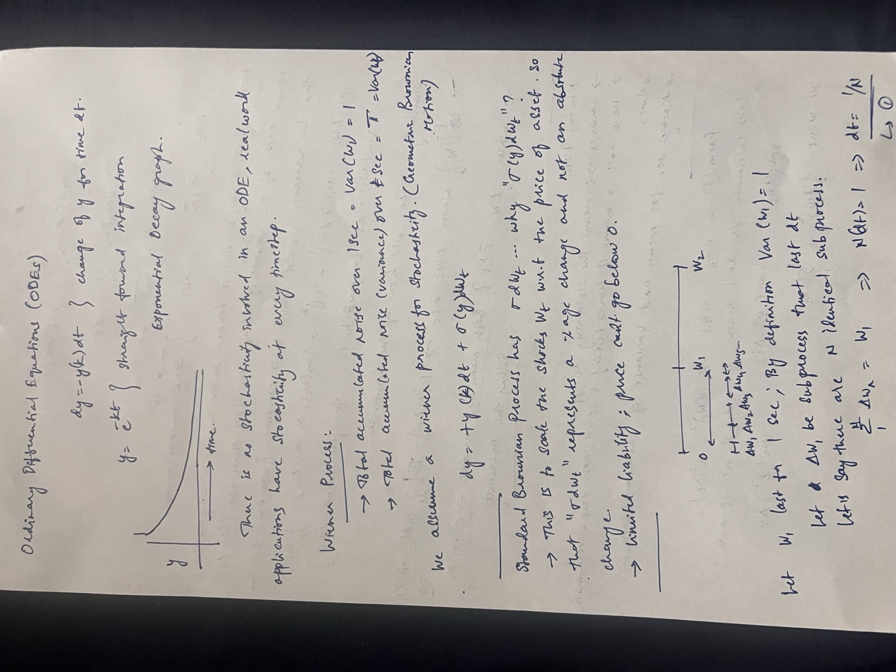
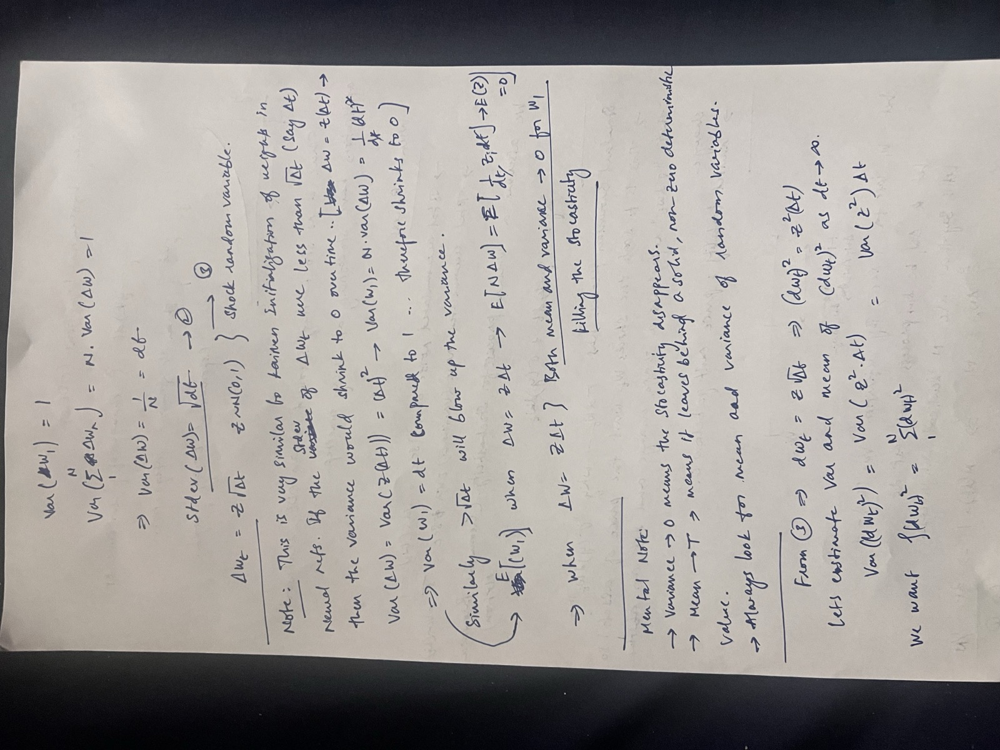
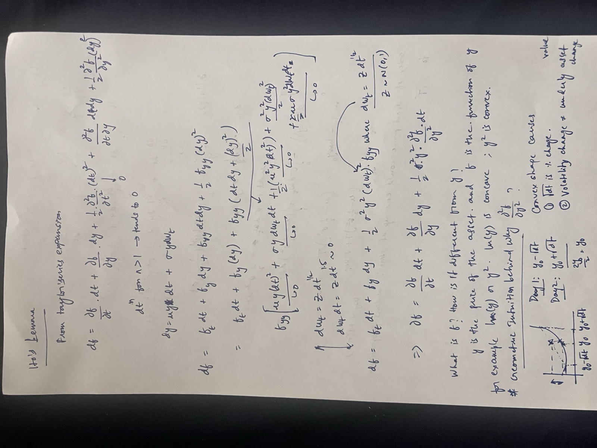
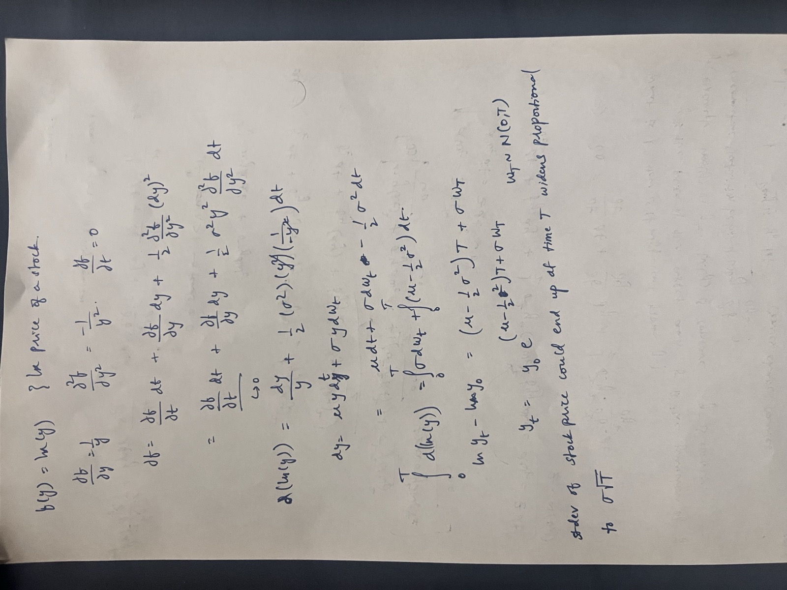

# Stochastic Calculus Derivations

SDE view of diffusion. In order: ODEs → SDEs → Wiener process → Itô's lemma → geometric Brownian motion.

1. [ODEs and SDEs](#1-odes-and-sdes)
2. [Wiener process](#2-wiener-process)
3. [Itô's lemma](#3-itôs-lemma)
4. [Geometric Brownian motion](#4-geometric-brownian-motion)

## 1. ODEs and SDEs

An ODE has no stochasticity:

$$dy = -ky\,dt \quad\Rightarrow\quad y = e^{-kt}$$

Add a Wiener process to get an SDE:

$$dy = \mu y\,dt + \sigma(y)\,dW_t$$

`σ(y)` instead of `σ` scales the shocks with the asset price, so `σ dW` is a % change, not an absolute one, and the price can't go below 0.

## 2. Wiener process

Split `W_1` into `N` steps of length `dt = 1/N`:

$$\mathrm{Var}(W_1) = N\,\mathrm{Var}(\Delta W) = 1 \;\Rightarrow\; \mathrm{Var}(\Delta W) = dt \;\Rightarrow\; \Delta W_t = Z\sqrt{dt},\quad Z \sim \mathcal{N}(0,1)$$

With `ΔW = Z·dt` instead, both the mean and variance of `W_1` go to 0, killing the stochasticity. Similar to Kaiming initialization.

## 3. Itô's lemma

From the Taylor expansion, for `dy = μy dt + σy dW`. The `dt²` and `dt·dW` terms vanish, and `(dW)²` becomes `dt`:

$$df = \frac{\partial f}{\partial t}dt + \frac{\partial f}{\partial y}dy + \frac{1}{2}\sigma^2 y^2 \frac{\partial^2 f}{\partial y^2}dt$$

The extra `½σ²y² ∂²f/∂y²` term comes from the convexity of `f`.

## 4. Geometric Brownian motion

Apply Itô's lemma to `f(y) = ln(y)`:

$$d(\ln y) = \left(\mu - \tfrac{1}{2}\sigma^2\right)dt + \sigma\,dW_t \;\Rightarrow\; y_T = y_0\, e^{\left(\mu - \frac{1}{2}\sigma^2\right)T + \sigma W_T},\quad W_T \sim \mathcal{N}(0, T)$$

The spread of where the price can end up at time `T` widens proportional to `σ√T`.

